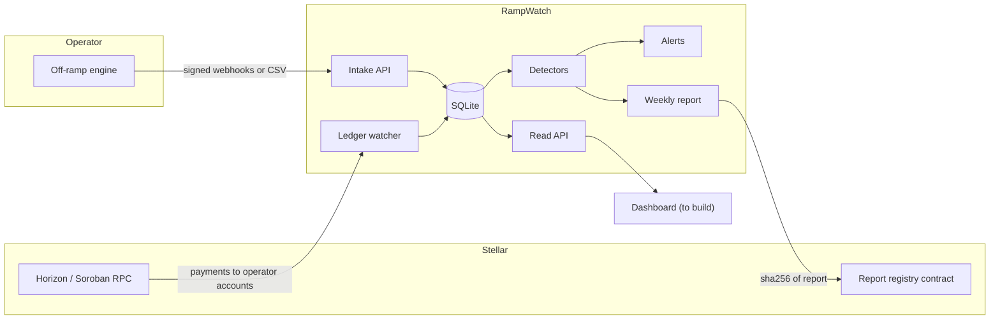
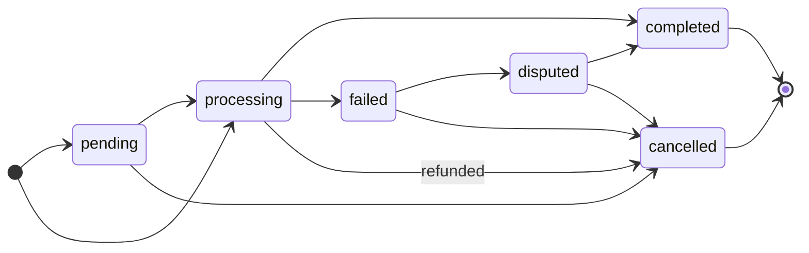
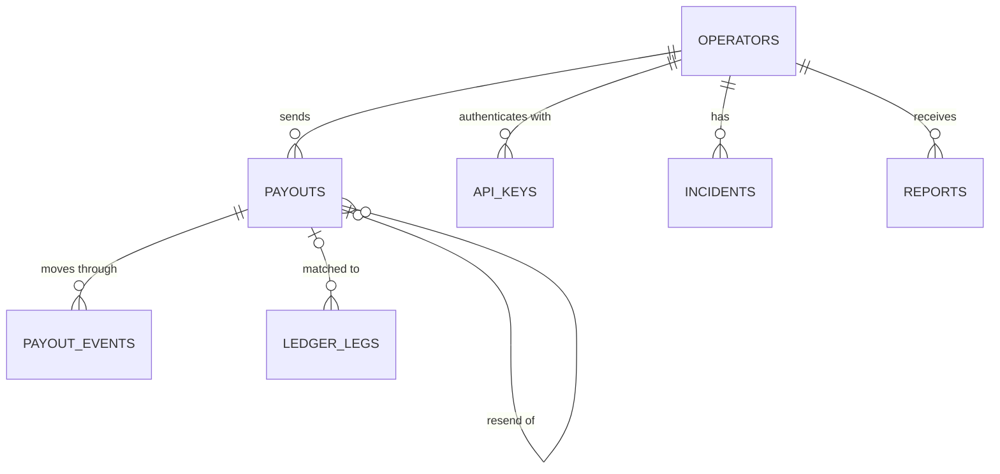
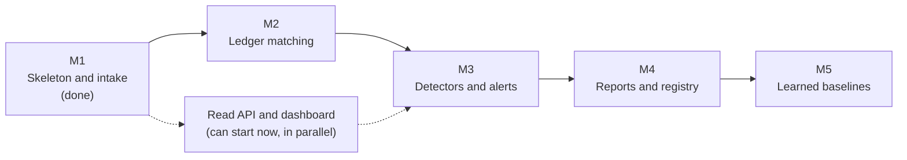

# RampWatch

**Health monitoring for off-ramp and payout operators on Stellar**

Repository: https://github.com/King-Boye/RampWatch
Design: Figma file (link to be added)

---

## Overview

Teams that turn Stellar assets into local money run their own payout rails: wallets with their own liquidity, remittance apps and anchors. When a cash-out stalls, fails or is sent twice, they usually find out from an angry customer or at month-end reconciliation.

RampWatch gives these operators one place to see the health of their payout rails. The operator sends every cash-out state change to RampWatch. RampWatch checks each change against a payout state machine and against the Stellar ledger, and reports:

- whether each corridor (starting with NG, GH, KE and RW) is **up, degraded or down**
- which cash-outs are **stuck**, and for how long
- which resends were safe, and which may have **paid the user twice**
- a **0 to 100 health score** per corridor
- a **weekly report** whose hash is anchored on Stellar, so the operator can prove to partners and regulators that it was not edited afterwards

RampWatch does not move money. It observes, matches and alerts.

---

## Architecture



### Components

| Component | Role | Status |
| --- | --- | --- |
| **Intake API** | Receives payout events as single webhooks, batches of up to 500, or CSV files. Checks the API key, the HMAC signature and the idempotency key, then applies the event to the state machine. | Built |
| **Store** | SQLite through sqlx, with migrations. Every write runs in an immediate transaction so concurrent events for one payout cannot race. | Built |
| **Ledger watcher** | Polls Stellar for payments to and from each operator's accounts and matches them to payouts by memo or transaction hash. | Milestone 2 |
| **Detectors** | Stuck payouts, unsafe resends and possible double payments, corridor anomalies, health scores, reserve levels. | Milestone 3 |
| **Alerts** | Telegram, Slack and outgoing webhooks, with per-corridor rules. | Milestone 3 |
| **Weekly report and registry** | A canonical JSON report per operator per week. Its sha256 is written to a Soroban registry contract. | Milestone 4 |
| **Read API** | Endpoints the dashboard reads: corridors, payouts, incidents, reports. | Not started |
| **Dashboard** | Web interface for operators. | Not started (design ready in Figma) |

### Technology

| Layer | Choice |
| --- | --- |
| Backend | Rust, Axum 0.8, Tokio, tower |
| Database | SQLite via sqlx 0.8 (migrations embedded in the binary) |
| Auth | Argon2id-hashed API keys, HMAC-SHA256 request signing, admin token |
| Caching and rate limits | Redis when available, in-memory fallback |
| Smart contract | Soroban (Rust), workspace crate `rampwatch-registry` |
| CI and security | GitHub Actions: rustfmt, Clippy, tests, cargo-deny, OSV-Scanner, ClamAV, gitleaks, CodeQL, Dependabot |

### Payout state machine

Every incoming event is checked against this machine. An illegal move is rejected with `409 invalid_transition` and opens an incident, because it reveals a bug in the operator's engine. Repeating the current state is accepted and has no effect.



A resend is never a reset. It is a new payout with `attempt + 1` and a link to the payout it replaces, so the full chain is kept for the double-payment checks.

### Request security

Each intake request carries:

- `Authorization: Bearer <api_key>`: the key is stored as an Argon2id hash and is shown only once, at creation.
- `X-RampWatch-Timestamp`: must be within 300 seconds, which blocks replayed requests.
- `X-RampWatch-Signature`: hex `hmac_sha256(secret, timestamp + "." + body)`.
- `X-RampWatch-Signature-Secondary`: optional. During a secret rotation the old secret stays valid for 24 hours, so operators can switch over without downtime.
- `Idempotency-Key`: if the same key arrives again with the same body, RampWatch returns the stored response with `X-Idempotent-Replayed: true`. The same key with a different body returns `409 idempotency_conflict`.

### Data model



The schema also holds `corridor_metrics`, `idempotency_records`, rate-limit settings, and tables for alert rules, alert history and Telegram subscriptions, which milestone 3 will use.

---

## Where we are now

**Milestone 1 (skeleton and intake) is complete.**

| Area | Done |
| --- | --- |
| Workspace | Cargo workspace with `backend/` and `contracts/registry/` |
| Operators | Admin endpoint creates an operator and returns its API key and HMAC secret once. Secret rotation with a 24-hour grace period. |
| API keys | Operators list, create, rotate and revoke their own keys. Per-key rate limits. |
| Intake | Single event, batch (up to 500) and CSV import, all through the same validation and state machine |
| Safety | HMAC signing, timestamp window, idempotent replays, conflict detection, immediate transactions |
| Incidents | Illegal state changes open an `illegal_transition` incident |
| Operations | Request IDs, graceful shutdown, environment validation at startup, `/health` endpoint |
| Tests | 90 unit tests and 10 integration tests, all passing |
| Repository | Required checks on `main`: format, Clippy, build and test, dependency audit, malware scan, secret scan, CodeQL. Dependabot opens update PRs weekly and merges minor updates once checks pass. |

What does not exist yet:

- **No frontend.** There is no web interface in the repository at all. Operators can only use RampWatch through the HTTP API and `curl`.
- No ledger matching, detectors, alerts or reports.
- No read endpoints: data goes in, but nothing yet serves payouts, corridors or incidents back out.
- The registry contract is an empty placeholder crate.

---

## The frontend

RampWatch currently has **no frontend**. Everything built so far is backend: the intake API, the database and the security around them. That is enough for an operator's engine to report events, but not for a person to see what is happening.

The dashboard is what turns RampWatch from an API into a product. An operations lead should be able to open it and see in a few seconds which corridors are healthy, which payouts are stuck and whether anyone may have been paid twice.

### Design

The dashboard has been designed in **Figma** (link to be added). The design is the reference for layout, components and visual style. The frontend should be built from it rather than designed again in code.

### Screens to build

| Screen | Purpose |
| --- | --- |
| Sign in | Operator users log in (email and password or magic link, plus optional 2FA) |
| Overview | Corridor health board: score ring and status per corridor, volume, success rate, p50 settle time, open incidents |
| Corridor detail | Score history, uptime timeline in 5-minute buckets, failure reasons, settle-time distribution |
| Payouts | Searchable, filterable table (state, corridor, date, amount, attempt). Stuck payouts highlighted with how long they have waited. |
| Payout detail | Event timeline, resend chain, matched ledger transactions with links to a Stellar explorer |
| Incidents | Open and resolved incidents by severity, with acknowledge and resolve actions |
| Alerts | Alert rules per corridor, delivery channels (Telegram, Slack, webhook), delivery history |
| Reports | Weekly reports, download as JSON or PDF, anchoring transaction and a "verify on Stellar" check |
| Settings | API keys (create, rotate, revoke), HMAC secret rotation, Stellar accounts, stuck-payout thresholds, team members |
| Integration guide | How to sign requests, sample code, a test console that sends a signed sample event |

### Suggested stack

- Next.js (App Router) with TypeScript, or React with Vite
- Tailwind CSS with design tokens taken from the Figma file
- TanStack Query for API data, with polling or server-sent events for live status
- A charting library for score history and timelines (for example Recharts or ECharts)
- Playwright for end-to-end tests, run in the same CI as the backend
- Lives in `frontend/` in this repository, so one pull request can change the API and the screen together

---

## What we need to add

### Backend

**Needed by the frontend**

- [ ] User accounts for people, separate from API keys: users, sessions or JWT, password hashing, roles (owner, admin, viewer), invitations
- [ ] Read API: `GET` corridors, corridor metrics, payouts with filters and pagination, payout detail with events and ledger legs, incidents, reports
- [ ] Live updates through server-sent events or WebSocket for corridor status and new incidents
- [ ] CORS configuration for the dashboard origin
- [ ] OpenAPI specification generated from the routes, so the frontend client can be generated and kept in sync
- [ ] Incident actions: acknowledge, resolve, add a note

**Milestone 2: ledger matching**

- [ ] Stellar client with retries, circuit breaker and rate limiting
- [ ] One poller per network that follows payments to and from each operator's accounts, with a saved cursor so restarts resume
- [ ] Matcher that links payments to payouts by memo or transaction hash and records ledger legs
- [ ] Mismatch incidents: completed without a ledger payment, ledger payment with no payout, amount differences

**Milestone 3: detectors and alerts**

- [ ] Stuck-payout detector using each operator's threshold
- [ ] Resend checks: parent not failed, unverified retry, possible double payment
- [ ] Corridor metrics in 5-minute buckets, and the health score (40% uptime, 35% success rate, 25% speed)
- [ ] Anomaly detection on failure rate and settle time
- [ ] Reserve-level checks on operator accounts
- [ ] Alert delivery to Telegram, Slack and webhooks, with rules, deduplication and history

**Milestone 4: reports and registry**

- [ ] Weekly canonical JSON report per operator, plus a PDF version
- [ ] Soroban registry contract that stores report hashes, with tests
- [ ] Anchoring job and a public verification endpoint

**Milestone 5: learned baselines**

- [ ] Per-corridor baselines learned from pilot data, replacing fixed thresholds

**Operations**

- [ ] PostgreSQL support for larger deployments
- [ ] Prometheus metrics and structured logs
- [ ] Docker image and deployment configuration
- [ ] Data retention and purge jobs
- [ ] Audit log of admin and user actions

### Frontend

- [ ] Create `frontend/` and set up the stack, linting, formatting and tests
- [ ] Turn the Figma file into design tokens and a component library (score ring, status badge, data table, timeline, charts)
- [ ] Sign-in and session handling
- [ ] Overview corridor board
- [ ] Corridor detail
- [ ] Payouts list and payout detail with resend chain and ledger links
- [ ] Incidents with acknowledge and resolve
- [ ] Alert rules and delivery history
- [ ] Reports with download and on-chain verification
- [ ] Settings: API keys, secret rotation, accounts, thresholds, team
- [ ] Integration guide with a signed test-event console
- [ ] Live updates for status and incidents
- [ ] Responsive layout, dark mode, accessibility (keyboard use, contrast, reduced motion)
- [ ] Frontend jobs in CI: lint, type check, unit tests, Playwright, dependency and malware scans
- [ ] Preview deployments for each pull request

---

## Roadmap



The read API and the dashboard do not have to wait for milestones 2 to 4. They can start now against the intake data that already exists, and pick up corridor scores, incidents and reports as each milestone lands.

---

## Running locally

```bash
git clone https://github.com/King-Boye/RampWatch.git
cd RampWatch
cp .env.example .env        # set ADMIN_TOKEN (at least 32 characters)
cargo run -p rampwatch-backend
```

Create an operator:

```bash
curl -X POST localhost:8080/v1/admin/operators \
  -H "Authorization: Bearer $ADMIN_TOKEN" -H 'content-type: application/json' \
  -d '{"name":"Demo Wallet","stellar_accounts":["G..."]}'
```

Send a signed event:

```bash
RAMPWATCH_API_KEY=rw_live_... RAMPWATCH_HMAC_SECRET=whsec_... \
  scripts/send_event.sh processing co_8f2a
```

Run the tests:

```bash
cargo build && cargo test
```
