<p align="center">
  
</p>

<p align="center">
  <a href="https://github.com/King-Boye/RampWatch/actions/workflows/ci.yml"></a>
  <a href="https://github.com/King-Boye/RampWatch/actions/workflows/security.yml"></a>
  <a href="https://github.com/King-Boye/RampWatch/actions/workflows/codeql.yml"></a>
  
  
</p>

RampWatch watches the health of teams that run their own off-ramp or payout rails on Stellar: wallets with their own liquidity, remittance apps and anchors. The operator sends every cash-out state change. RampWatch checks it against the payout state machine and the Stellar ledger, and tells the operator:

- whether each corridor (NG, GH, KE, RW to start) is **up, degraded or down**
- which cash-outs are **stuck**, and for how long
- which resends were safe, and which may have **paid the user twice**
- a **0 to 100 health score** per corridor, plus a weekly report whose hash is **anchored on Stellar**

## How it works

<p align="center">
  
</p>

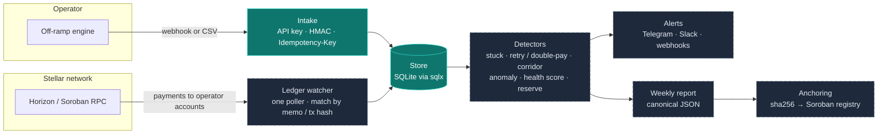

Solid boxes are built; dashed boxes arrive in milestones 2 to 4.

## Payout state machine

Every event is checked against this machine, ported from SwiftRemit. An illegal move is rejected with `409 invalid_transition` and opens an `illegal_transition` incident, because it says something about the operator's engine.

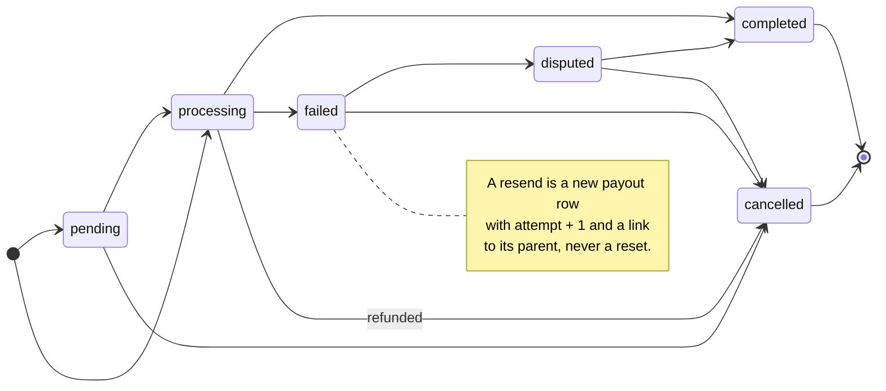

## What happens to one event

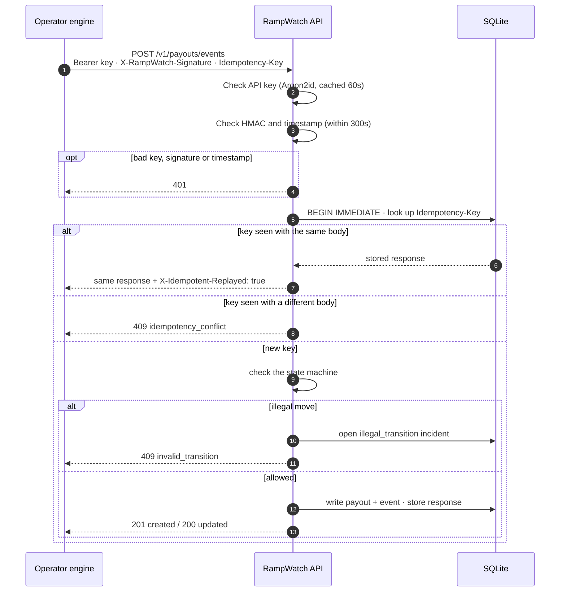

## Corridor health

<p align="center">
  
</p>

Each corridor gets a score from 0 to 100, ported from AnchorKit's anchor health score with reputation replaced by measured reliability:

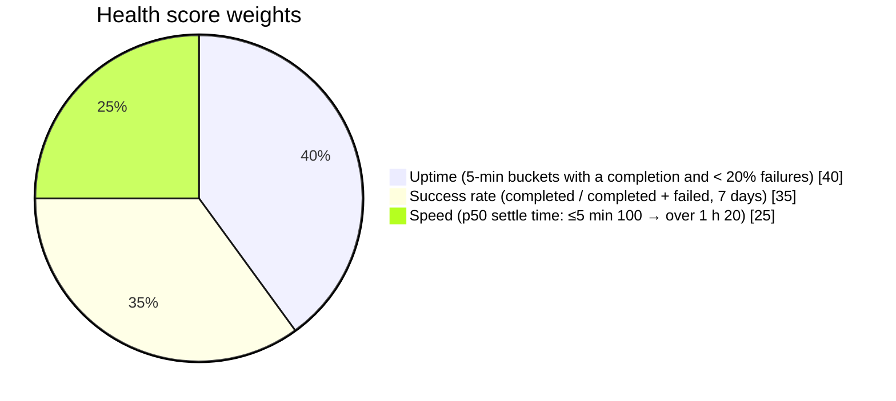

| Score | Status |
| --- | --- |
| 85 to 100 | 🟢 healthy |
| 60 to 84 | 🟡 degraded |
| below 60 | 🔴 down |

## Resends and double pays

The detectors (milestone 3) look at every resend chain:

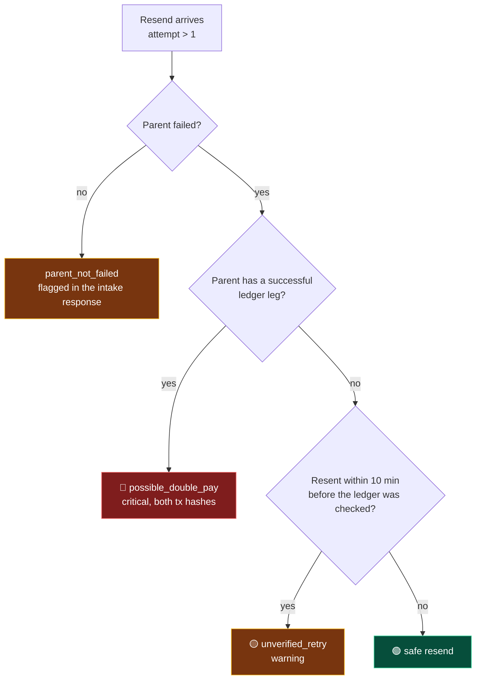

## Data model

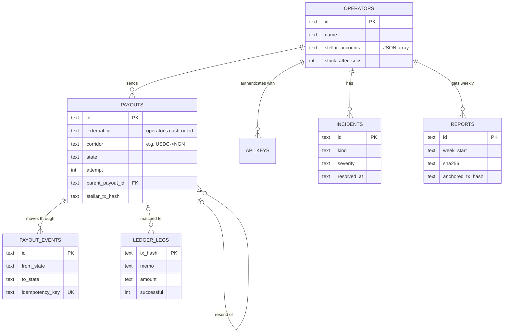

## Status

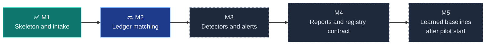

Workspace:

- `backend/`: Rust / Axum API (SQLite via sqlx)
- `contracts/registry/`: Soroban report registry, crate `rampwatch-registry` (milestone 4)

## Run

```bash
cp .env.example .env        # set ADMIN_TOKEN (32+ chars)
cargo run -p rampwatch-backend
```

Create an operator (the API key and HMAC secret are shown once):

```bash
curl -X POST localhost:8080/v1/admin/operators \
  -H "Authorization: Bearer $ADMIN_TOKEN" -H 'content-type: application/json' \
  -d '{"name":"Demo Wallet","stellar_accounts":["G..."]}'
```

Send a signed event:

```bash
RAMPWATCH_API_KEY=rw_live_... RAMPWATCH_HMAC_SECRET=whsec_... scripts/send_event.sh processing co_8f2a
```

## Intake API

All intake routes need `Authorization: Bearer <api_key>` and an HMAC signature:

- `X-RampWatch-Timestamp`: unix seconds (or RFC 3339), within 300s
- `X-RampWatch-Signature`: hex `hmac_sha256(secret, timestamp + "." + body)`
- `X-RampWatch-Signature-Secondary`: optional, during a secret rotation

| Method | Path | |
| --- | --- | --- |
| POST | `/v1/payouts/events` | One event. `Idempotency-Key` header required. A replay returns the first response with `X-Idempotent-Replayed: true`. |
| POST | `/v1/payouts/events/batch` | Up to 500 events (`{"events":[...]}`), each processed on its own |
| POST | `/v1/payouts/import` | CSV with a header row, same fields |
| GET/POST/DELETE | `/v1/api-keys`, `/v1/api-keys/{id}`, `/v1/api-keys/{id}/rotate` | Operator manages its own keys |
| POST | `/v1/admin/operators` | Create operator (admin token) |
| POST | `/v1/admin/operators/{id}/rotate-secret` | New HMAC secret; old one valid 24h |
| GET | `/health` | Liveness |

## Test

```bash
cargo build && cargo test
```

## Checks before every merge

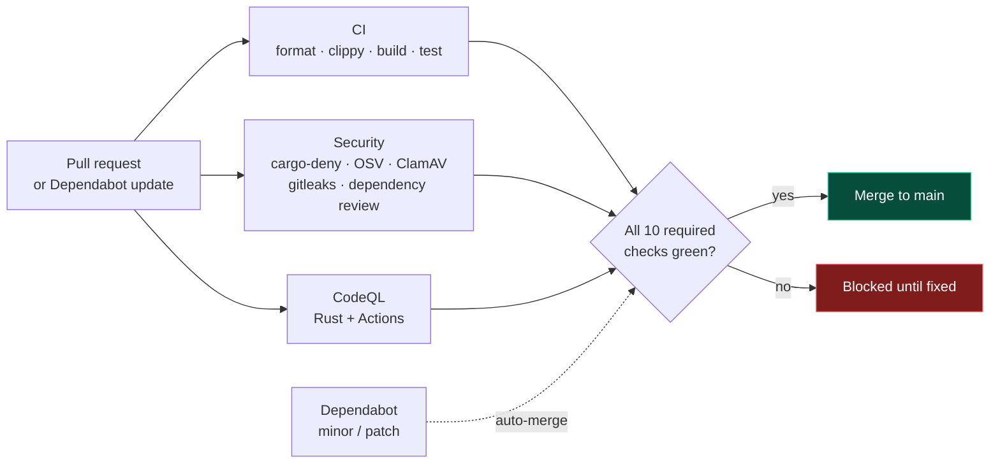

Dependency, malware and CodeQL scans also rerun every Monday. Details in [SECURITY.md](SECURITY.md).

